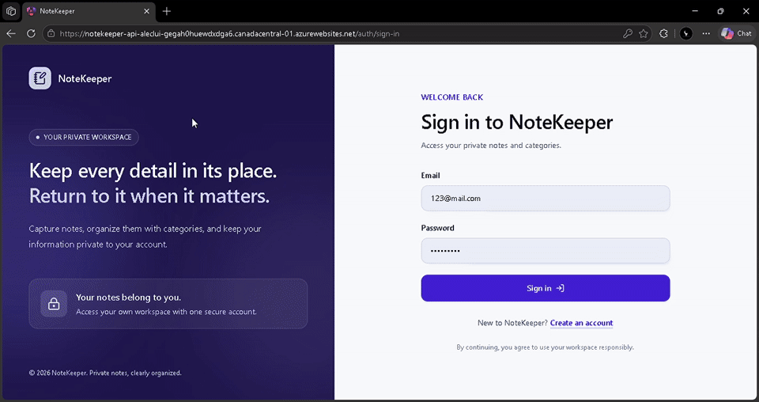
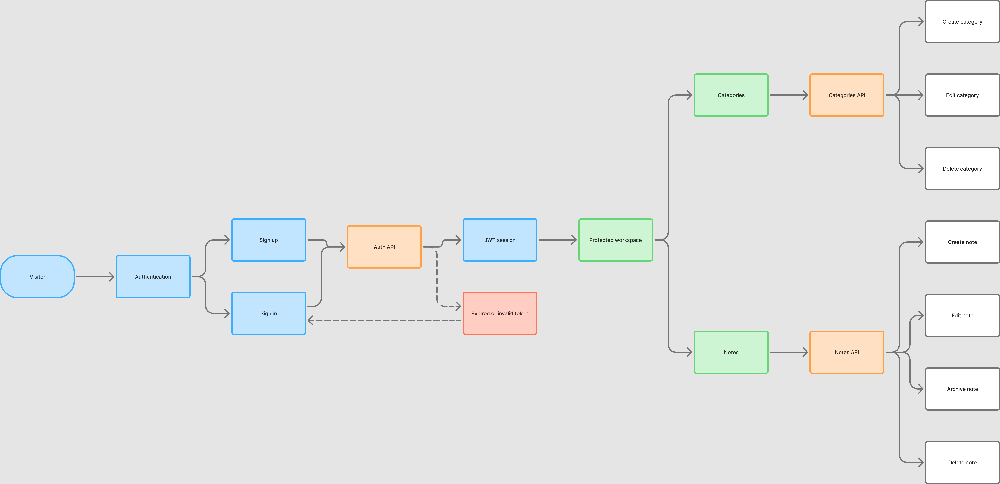
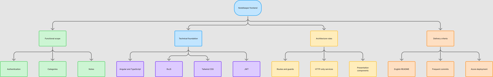
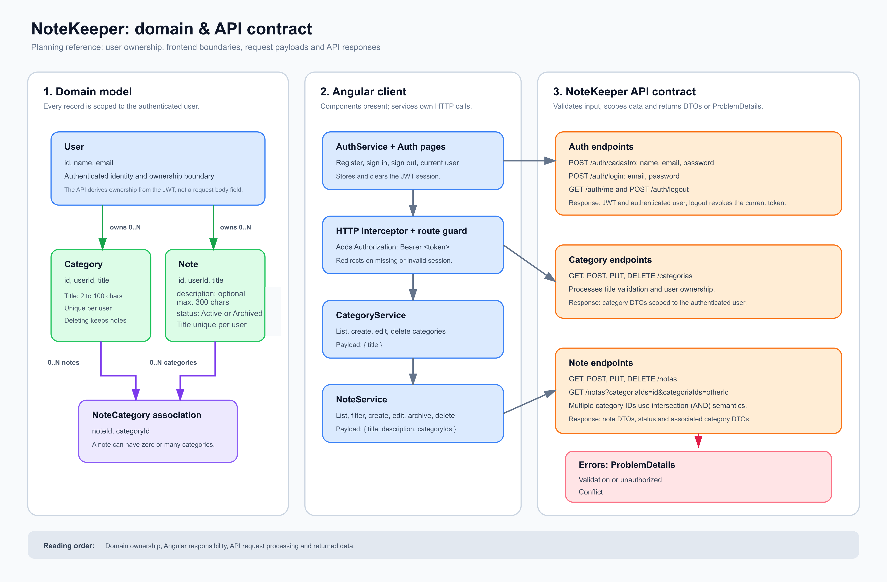

# NoteKeeper

[](https://notekeeper-api-aleclui-gegah0huewdxdga6.canadacentral-01.azurewebsites.net/)
[](https://notekeeper-api-aleclui-gegah0huewdxdga6.canadacentral-01.azurewebsites.net/swagger)

[](https://dotnet.microsoft.com/)
[](https://swagger.io/)
[](https://learn.microsoft.com/ef/core/)
[](https://learn.microsoft.com/aspnet/core/security/authentication/identity)
[](https://nodejs.org/)
[](https://angular.dev/)
[](https://tailwindcss.com/)
[](https://lucide.dev/)

NoteKeeper is a full-stack personal workspace for securely organizing notes and categories. It combines an Angular client with a .NET API, JWT authentication, SQL Server persistence, and automated Azure deployment.

**Live application:** [Open NoteKeeper](https://notekeeper-api-aleclui-gegah0huewdxdga6.canadacentral-01.azurewebsites.net/)

**API documentation:** [Open Swagger](https://notekeeper-api-aleclui-gegah0huewdxdga6.canadacentral-01.azurewebsites.net/swagger)

## Contents

- [Demonstration](#demonstration)
- [Features](#features)
- [Technology](#technology)
- [Architecture and planning](#architecture-and-planning)
- [API (server)](#api-server)
- [Deployment](#deployment)
- [Project structure](#project-structure)

## Demonstration

The complete walkthrough shows account creation, authentication, category management, note creation, editing, filtering, archiving, and deletion.



## Features

- Account creation, sign in, persisted JWT sessions, sign out, and protected workspace routes.
- User-isolated notes and categories.
- Category creation, listing, editing, and deletion.
- Note creation, editing, archiving, deletion, category filtering, and local title search.
- Responsive Angular interface built with Signal Forms, Signals, RxJS, Tailwind CSS, and Lucide icons.

## Technology

| Area | Technologies |
| --- | --- |
| Client | Angular 22, TypeScript, Signal Forms, Signals, RxJS, Angular Router |
| UI | Tailwind CSS and Lucide Icons |
| API | .NET 10, ASP.NET Core, Controllers, OpenAPI, Swagger UI |
| Application layer | MediatR and FluentResults |
| Security | ASP.NET Core Identity, JWT Bearer authentication, token revocation |
| Data | Entity Framework Core and SQL Server |
| Delivery | GitHub Actions, Azure App Service, Azure SQL Database |

## Overview

NoteKeeper helps users keep ideas and important information in one organized place. Notes can be grouped by categories, searched by title, and archived when they are no longer active.

## Authentication

### Functional requirements

- Allow users to create an account with name, email, and password.
- Allow users to sign in with email and password.
- Keep the authenticated session and allow users to sign out.
- Display the authenticated user's name in the interface.
- Restrict personal workspace features to authenticated users.

### Business rules

- **Name:** required and used to identify the user in the interface.
- **Email:** required, valid, and unique.
- **Password:** required, with at least 8 characters, including a number and a special character.
- Protected operations use the JWT issued for the session.
- Each user can access only their own notes and categories.

## Categories

### Functional requirements

- Create categories.
- List registered categories.
- Edit existing categories.
- Delete categories.

### Business rules

- **Title:** required, from 2 to 100 characters.
- Duplicate category titles are not allowed.

## Notes

### Functional requirements

- Create notes.
- List registered notes.
- Associate notes with one or more categories.
- List notes associated with specified categories.
- Edit existing notes.
- Delete notes.

### Business rules

- **Title:** required, from 2 to 100 characters.
- **Description:** optional, up to 300 characters.
- **Status:** active or archived.
- New notes start as **active**.
- **Categories:** optional. A note may have no category.
- Duplicate note titles are not allowed.

## API (server)

The API is located in `server/` and uses .NET 10, ASP.NET Core Identity, JWT Bearer, EF Core, and SQL Server. Configure a SQL Server connection string and JWT signing key of at least 32 bytes with User Secrets:

```bash
dotnet user-secrets set "ConnectionStrings:SqlServer" "<connection-string-sql-server>" --project server/src/Api/NoteKeeper.Api.csproj
dotnet user-secrets set "Jwt:SigningKey" "<chave-aleatoria-com-pelo-menos-32-bytes>" --project server/src/Api/NoteKeeper.Api.csproj
dotnet user-secrets set "LuckyPenny:LicenseKey" "<lucky-penny-license-key>" --project server/src/Api/NoteKeeper.Api.csproj
dotnet tool restore --tool-manifest server/dotnet-tools.json
dotnet ef database update --project server/src/Infraestrutura/NoteKeeper.Infraestrutura.csproj --startup-project server/src/Api/NoteKeeper.Api.csproj
dotnet run --project server/src/Api/NoteKeeper.Api.csproj
```

In development, the API applies migrations at startup. Swagger/OpenAPI is available at `/swagger`, and request examples are in `server/src/Api/NoteKeeper.Api.http`.

| Method                 | Route              | Access  | Operation                           |
| ---------------------- | ------------------ | ------- | ----------------------------------- |
| `POST`                 | `/auth/cadastro`   | Public | Creates an account with name, email, and password. |
| `POST`                 | `/auth/login`      | Public | Authenticates and returns a JWT. |
| `GET`                  | `/auth/me`         | Bearer | Returns the current user. |
| `POST`                 | `/auth/logout`     | Bearer | Immediately revokes the current JWT. |
| `GET`, `POST`          | `/categorias`      | Bearer | Lists and creates categories. |
| `GET`, `PUT`, `DELETE` | `/categorias/{id}` | Bearer | Reads, updates, and deletes a category. |
| `GET`, `POST`          | `/notas`           | Bearer | Lists, filters, and creates notes. |
| `GET`, `PUT`, `DELETE` | `/notas/{id}`      | Bearer | Reads, updates, and deletes a note. |

Titles are unique per user without case or outer-space differences. Deleting a category preserves the notes and removes only their associations. A note `PUT` replaces its category list, so use `categoriaIds: []` to remove all associations. Sessions do not use refresh tokens, so users must sign in again after expiration. Errors follow `ProblemDetails`, including per-field validation messages.

To filter notes by category, send `categoriaIds` one or more times in the `GET /notas` query string, such as `GET /notas?categoriaIds=<id1>&categoriaIds=<id2>`. The filter is exclusive: multiple IDs return only notes associated with **all** supplied categories. Without the parameter, the route returns all notes for the authenticated user.

Application use cases are implemented as MediatR requests and handlers. FluentResults represents outcomes and errors, which the API converts into HTTP responses.

Build and test:

```bash
dotnet build server/NoteKeeper.slnx --configuration Release
dotnet test server/NoteKeeper.slnx
```

## Architecture and planning

The implementation was planned through diagrams that define the user journey, client-server dependencies, and domain contract.

[Read the implementation plan](references/DEVELOPMENT_PLAN.md)

### Usability flow



### Dependencies and requirements



### Domain and API contract



## Deployment

The GitHub Actions workflow validates the server, applies pending EF Core migrations with retry protection for Azure SQL Serverless wake-up periods, builds the Angular client, and deploys one combined package to Azure App Service.

The Angular build is served by ASP.NET Core from `wwwroot`. This lets the client call the API through the same origin, while Swagger remains available at `/swagger`.

Production secrets stay outside source control in Azure App Service and GitHub Secrets:

- SQL Server connection string
- JWT issuer, audience, and signing key
- Allowed CORS origins for local development
- Azure publish profile

## Project structure

```text
NoteKeeper/
├── client/                 Angular application
│   └── src/app/
│       ├── auth/           Authentication, session, interceptor, and guard
│       ├── categories/     Category screens and services
│       ├── notes/          Note screens and services
│       └── workspace/      Protected application shell and home
├── server/
│   ├── src/
│   │   ├── Api/            HTTP endpoints, authentication, and hosting
│   │   ├── Aplicacao/      Use cases, handlers, and application rules
│   │   ├── Dominio/        Domain entities and contracts
│   │   └── Infraestrutura/ EF Core, Identity, and SQL Server integration
│   └── tests/              Automated server tests
├── references/             Validated planning diagrams
└── assets/demo/            Demonstration media
```
